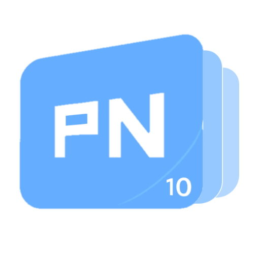

<p align="center">
  
</p>

<h1 align="center">ParkerEasiNote10 · 快捷白板</h1>

<p align="center"><b>让板书成为画面里唯一的主角</b></p>

<p align="center">
  
  
  
  
</p>

一个写给教室的网页白板：**纯 HTML / CSS / JavaScript，没有构建步骤、没有后端、没有 CDN 依赖**。拷到 U 盘、解压到任意目录，双击 `index.html` 就能上课。

笔迹带压感、手掌可当橡皮、打开 PPT / Word / PDF 就能直接开讲（PPT 与 PDF 可圈画，Word 自动分页阅读，PPT 里的音频视频可以直接点开），还带 22 个课堂与学科工具（含可录音导出的钢琴），以及一套可离线导出的课件格式。断网、没账号、没装软件，都不影响它开场。

> 面向的是「一台讲台电脑 + 一块触屏 / 数位板」的真实课堂，而不是通用绘图软件。

---

## 目录

- [一、这是什么](#一这是什么)
- [二、快速开始](#二快速开始)
- [三、功能地图](#三功能地图)
- [四、使用手册](#四使用手册)
- [五、实现原理](#五实现原理)
- [六、目录结构](#六目录结构)
- [七、二次开发](#七二次开发)
- [八、定制与部署](#八定制与部署)
- [九、已知限制](#九已知限制)
- [十、常见问题](#十常见问题)
- [十一、参与贡献](#十一参与贡献)
- [十二、致谢与许可](#十二致谢与许可)

---

## 一、这是什么

### 定位

ParkerEasiNote10（原名「快捷白板10」）是一个**离线优先的课堂白板**。它把老师上课真正会用的几件事做在一页里：

- **写**：低延迟手写、压感笔锋、手势橡皮、套索改板书；
- **讲**：打开现成的 PPT / Word / PDF，PPT 与 PDF 可直接圈画，Word 分页阅读；
- **备**：自己排课件页、加图形文字图片、打包成 `.pnbx`，下次直接放映；
- **补**：计时、板中板、随机点名、视频展台，以及汉字 / 拼音 / 古诗 / 几何 / 函数 / 公式 / 化学 / 3D 星球 / 思维导图 / 钢琴等学科与创作工具；
- **总结**（可选）：接一个大模型接口，把整页板书截图丢进去做总结，或圈一块直接提问。

### 非目标

它**不是**云文档、不是协作白板、不是账号体系。没有服务器，也就没有登录、同步、分享链接这些东西。所有数据都在本机浏览器里，退出即走。

### 特性一览

| 方面 | 说明 |
| --- | --- |
| 运行方式 | 双击 `index.html`，或任意静态服务器托管 |
| 依赖 | 全部本地化（JSZip / PDF.js / Three.js / MathJax / Font Awesome / face-api） |
| 构建 | 无。改完文件刷新即生效 |
| 代码量 | 约 13,900 行（其中内核 `js/app.js` 约 7,000 行） |
| 存储 | 浏览器 `localStorage`，单机保存与恢复 |
| 网络 | 默认零请求；仅「检查更新」「AI」「物理/化学实验外链」会联网，且都可不用 |
| 适配 | 桌面 / 触屏一体机 / 平板；手机窄屏可跑，但主画板会进入窄屏保护态（见[已知限制](#九已知限制)） |

### 最近更新（10.2.7）

- 选择工具优先级理顺：四角手柄 > 上层图片 > 当前选框 > 套索，重叠图片点哪张选哪张；
- 打开文件只列出真正支持的十来种格式，乱选会得到明确提示而不是静默失败；
- 计时器收起后胶囊重新可点；「更多」改为六列二级分组的单屏网格，去掉滚动与旧动画；
- 人脸模型改为内联加载，`file://` 下随机点名不再报 CORS；
- 3D 星球拖动方向与手势重做（拖动跟手、双指缩放、双击复位）；四线三格按字体度量对齐基线，字号随格高同步缩放；
- 学科工具参数栏改为常驻右侧并带图标；公式「结构」页按键补齐；化学方程式可标 ↑ / ↓；
- PDF 改为**追加页**，不再清空已有板书；PPT 放映新增「选择」工具，音视频可直接点击播放，底栏恢复原尺寸；
- 思维导图支持填充色与字体 / 字号；视频展台工具并入底栏、支持切换摄像头；
- **钢琴升级为 88 键**（A0–C8）并接入标准 88 音采样：升号 `Cs4` / 降号 `Db4` 两种命名都认，按 C4 峰值自动补增益，LRU 只留最近 40 个音，其余按需加载；
- **视频展台「冻结 + 插入」合并为「拍照」**：一拍即插入新的一页并退出展台，原板书一页不动；
- **展台双指缩放重写**：修正了缩放原点少减半个视口的偏移（以前一捏画面就甩向左上）、捏合期间去掉 0.18 s 过渡、改幂曲线响应，并让两指中点跟随；不必先切「移动」模式；
- **选中图片后可直接双指捏合缩放**，不用再去按四角手柄；套索选区同样适用；
- 关于页极光换成流动模糊光晕，老内核自动退回纯渐变。

### 浏览器要求

Chrome / Edge 90+、Firefox 90+、Safari 15+。依赖 Pointer Events、ResizeObserver、Canvas 2D；3D 星球需要 WebGL，朗读需要系统语音包，视频展台需要摄像头权限。

---

## 二、快速开始

### 方式一：直接打开（最快）

```
下载 / 解压 → 双击 ParkerEasiNote10/index.html
```

多数功能在 `file://` 下可用。以下三项受浏览器安全策略限制，建议改用方式二：

- 视频展台（`getUserMedia` 要求安全上下文）
- PDF 的 Web Worker（部分内核会退回主线程解析，速度变慢）
- 启动时的更新检查（`file://` 下直接跳过，不报错）

### 方式二：本地静态服务器（推荐）

```bash
cd ParkerEasiNote10
python3 -m http.server 8080
# 浏览器打开 http://localhost:8080
```

Node 也可以：

```bash
npx serve .
```

### 方式三：部署到静态托管

它就是一个静态目录，扔到 Nginx / GitHub Pages / 对象存储 / 内网共享盘都行。Nginx 最小配置：

```nginx
server {
    listen 80;
    root /var/www/ParkerEasiNote10;
    index index.html;
    location / {
        try_files $uri $uri/ /index.html;
    }
}
```

> 摄像头相关功能需要 HTTPS（`localhost` 除外）。其余功能 HTTP 即可。

### 第一次打开建议做三件事

1. 点左下 **菜单 → 设置**，把「界面缩放」调到看着舒服的比例（25%–200%）；
2. 在**设置 → 手势橡皮**里确认开关与灵敏度（默认开启、适中）；
3. 如果要写公式或用 AI，先看[公式编辑](#46-公式编辑)和 [AI 配置](#411-ai-配置)。

---

## 三、功能地图

| 模块 | 能力 |
| --- | --- |
| **板书** | 压感笔迹、手势橡皮、19 种图形、套索选择/移动/缩放/复制、多页、目录缩略图、撤销（最多 60 条快照） |
| **屏幕** | 视频展台（缩放、平移、双指捏合、拍照入新页、切摄像头）、当前页导出 PNG |
| **文件** | 打开 `.pptx` / `.docx` / `.pdf` / 图片 / `.txt` / `.md`；PPT 与 PDF 可圈画（PDF 追加页），Word 分页阅读，PPT 音视频可播放 |
| **备课** | 页面排版（图形/文字/图片/层级顺序）、放映、导出与打开 `.pnbx` 课件 |
| **课堂工具** | 计时器（可收起）、板中板、随机点名（可选摄像头人脸框）、视频展台 |
| **学科工具** | 汉字、拼音、古诗词、四线三格、音标、英汉字典、听写、几何画板、函数工具、公式编辑、化学方程式、3D 星球、思维导图 |
| **创作** | 思维导图（填充色/字体/字号）、钢琴（演奏、录音、回放、导出 WAV）、插入图片、网页扩展 |
| **AI（可选）** | 整页总结、圈选提问、多轮对话、看图；兼容任意 OpenAI 格式接口 |

「更多」按 **6 组 22 项**铺满一屏，不滚动：

| 分组 | 工具 |
| --- | --- |
| 课堂 | 计时器、板中板、随机点名、视频展台 |
| 语文 | 汉字、拼音、古诗词、听写 |
| 数学 | 几何画板、函数工具、公式编辑 |
| 英语 | 四线三格、音标、英汉字典 |
| 理科 | 化学方程式、3D 星球、物理实验、化学实验 |
| 创作 | 思维导图、钢琴、插入图片、网页扩展 |

> **物理实验 / 化学实验**是外链（NoBook），必须联网；其余工具全部离线。

---

## 四、使用手册

### 4.1 界面

| 位置 | 内容 |
| --- | --- |
| 底部中央 | 画笔、橡皮、选择、形状、撤销、更多、AI 总结 |
| 底部中央 | 画笔、橡皮、选择、形状、撤销、更多、AI 总结；**进入视频展台后**这一区右侧变成展台工具（移动/缩放/复位/拍照/切换） |
| 左下角 | 菜单、保存、视频展台（进入）、拍照（仅在展台里出现） |
| 右下角 | 加页、上一页、下一页、目录 |
| 右上角 | 时钟、页码 |

### 4.2 书写

- 点一下 **画笔** 切到笔，再点一下展开颜色与粗细（1–24 px），点空白处收起；
- 支持数位板 / 触屏压感：压力越大笔画越粗，起笔渐入、收笔收锋；
- 多根手指可以同时书写，互不打断；
- 笔迹保存的是**逻辑坐标**，不会因为 DPR、界面缩放或窗口大小变化而错位。

### 4.3 手势橡皮

笔模式下，用**手掌侧面或拇指侧面**这类大接触面积去擦，抬手自动回到笔，不用切工具。

- 判定依据是 PointerEvent 的接触椭圆尺寸（`width/height`），不是压力；
- 以你平时的接触面积做基线自适应，换设备不用重调；
- **设置 → 手势橡皮 → 灵敏度**：越灵敏阈值越接近普通笔迹，0 为关闭；
- 鼠标永远不会触发手势橡皮。

需要整块擦除时，点两次 **橡皮**，菜单里有「全部擦除」。

### 4.4 套索选择

点 **选择**，在画布上拖出一个圈：

- 圈住的内容变成一个可选对象，可整体拖动；
- 四角拖动缩放，工具条上可 **复制**、**问 AI**、取消；
- 只对圈内的笔迹/图形/图片生效，不会动到页外内容；
- 选中状态下按 **Esc** 或切换工具即提交。

### 4.5 形状

点 **形状** 展开 19 种图形：矩形、圆角矩形、圆、椭圆、三角、直角三角形、菱形、五边形、六边形、八边形、五角星、六角星、箭头（左右）、折角、平行四边形、梯形、十字、直线。选一种后在画布上拖出大小。

### 4.6 公式编辑

「更多 → 公式编辑」是一个**可以直接打字改**的 LaTeX 编辑器，不是只能点按钮的黑盒：

- 左栏输入框可以直接编辑，像改普通文字一样改公式；
- 下方按键面板分「常用 / 结构」两组，点一下把 `\frac{}{}` 这类骨架插到光标处，并自动选中花括号内部，接着敲数字即可；
- 右栏 6 个常用模板（求根公式、勾股定理、球体积、导数定义、等差数列、二项式），套完改数字；
- 预览实时刷新，写错会提示「检查括号是否成对」；
- 「插入白板」会把公式**栅格化成 PNG** 贴到板书上（原因见[原理](#57-公式为什么先转-png)）。

> 插入后是图片，不能再改字；要改就重新打开编辑器改完再插一次。

### 4.7 页面与目录

- 右下 **+** 加页，左右箭头翻页；
- **目录**打开缩略图抽屉，拖动可滚动，点缩略图跳页；
- 缩略图是增量绘制的：先出列表占位，再逐帧补内容，几十页也不会卡住打开动作。

### 4.8 保存、加载与导出

左下 **保存** 把当前白板（所有页的元素与图片）写进浏览器 `localStorage`，菜单 → **加载文件** 里可以恢复或删除。

> 这是**本机快照**，不是文件。换浏览器、清缓存就没了。要带走请用「导出图片」或备课模式的 `.pnbx`。

- 菜单 → **导出图片**：当前页导出 PNG；
- 菜单 → **打开文件**：见 4.10；
- 菜单 → **关闭白板并退出登录**：尝试真正关闭标签页；浏览器不允许时跳转 `about:blank`。

### 4.9 视频展台与拍照

点左下 **摄像头** 进入展台：画面可缩放、可平移，笔迹固定在屏幕上，不跟着画面动。工具都在**底部工具条**里：

| 按钮 | 作用 |
| --- | --- |
| 移动 | 拖动画面对位（不开这个模式时，单指是书写） |
| 缩小 / 放大 | 按步长缩放，中间显示百分比 |
| 复位 | 回到 1:1 居中 |
| 拍照 | 拍下当前画面（含屏幕上的批注）→ **自动新建一页** → 整幅插入 → 退出展台 |
| 切换 | 多摄像头设备间切换（笔记本内建 / USB 摄像头） |

**双指随时可缩放**：不用先进「移动」模式，两指一捏就生效；两指整体平移时画面跟着手走。缩放灵敏度做了曲线压缩（指数 0.8），大屏上两指张得开也不会一碰就翻倍。

**拍照**是「定格 + 落板」一步到位：拍完就在新的一页上，原来的板书一页都没动，接着在新页批注、圈画都行。左下角也有一个相机按钮，位置和以前的「冻结」一样，习惯不用改。

> 以前要先「冻结」再「插入」，两步才能落板；现在一步。想慢慢讲解再落板的话，直接在新页上批注即可，效果一样。

### 4.10 打开 PPT / Word / PDF

菜单 → **打开文件**，支持：

| 格式 | 处理方式 |
| --- | --- |
| `.pptx` | 解析为可翻页的幻灯片，文字/图片/表格/图表/SmartArt/公式按近似版式重建，内嵌音频视频可直接播放 |
| `.docx` | 解析段落、标题、列表、表格、图片，按当前屏幕重新分页 |
| `.pdf` | 逐页渲染成图片，**追加**为新的白板页（原有板书与页数全部保留） |
| `.pnbx` / `.zip` | 本程序导出的课件包 |
| 图片 / `.svg` | 插到当前页 |
| `.txt` / `.md` | 弹窗阅读（Markdown 渲染） |
| `.ppt` / `.doc` | 不支持，提示先另存为新格式 |

文件选择框只列出上面这些格式；强行选别的文件会得到「暂不支持这种文件」的提示，而不是静默失败。

打开后，PPT 进入文件模式，可以在幻灯片上直接圈画；PDF 追加为白板页，同样可以圈画；Word 目前只做分页阅读，不接受笔迹输入。**批注是屏幕墨迹，不会写回原文件**；PPT 的每一页各自独立保存，切回来还在。

> **PPT 里的音频、视频**：放映时切到「选择」工具（工具栏上的箭头），点子机上的播放按钮即可播放；画笔模式下点击不会触发播放，避免误触。

### 4.11 AI 配置

点 **AI 总结**：

- 第一次会要求填 API Key（支持 DeepSeek、通义千问兼容模式、智谱、Kimi、OpenAI，或任意 OpenAI 兼容地址）；
- 配置在 **设置 → AI 接口**，可改 `base` / `model` / `key`；
- 「整页总结」会把当前画布截图发给所配置的接口；
- 圈选后点 **问 AI**，选区图片会挂在聊天框上方，可以改问题再发；
- 聊天支持多轮、可附带图片；
- Key 保存在 `localStorage`，明文存储，公共电脑上用完请清掉。

> 这一整块完全可选。不配置 Key 时，其余功能不受影响，也不会发起任何网络请求。

### 4.12 钢琴

「更多 → 创作 → 钢琴」是一台 **88 键**（A0–C8）的完整钢琴，打开时自动把 C4 摆到中间：

- 点键或按电脑键盘弹奏（`A W S E D F T G Y H U J K` 依次是 C4–C5，`O L P ; '` 继续到 F5）；
- 键盘一屏放不下 88 键，**左右滑动**查看，或点「低音 A0–B2 / 中音 C3–B5 / 高音 C6–C8」一键跳过去；弹到视野外的键会自动滚进来；
- 右侧参数栏调**音量**与**移调**（±12 半音），下方显示当前是采样音色还是合成音色；
- **录音**记录你弹的音符（音高、时刻、时值、力度），**回放**原样重放，**导出 WAV** 存成本地音频文件；
- 录音与回放互斥，回放中再按录音会先停掉回放；清空按钮只删录音，不影响演奏。

音色优先读 `assets/piano/` 下的采样（见[换钢琴音色](#换钢琴音色)），没有采样时自动退回 Web Audio 合成，因此**即使一个音频文件都没有，它也能出声**。

内置的这批采样录得比较轻（峰值只有 0.06 左右），所以播放时会按 C4 的峰值自动补一个增益，正常采样则会自动退回 1 倍，不需要手工调。

---

## 五、实现原理

这一节解释「为什么这样写」，以及几个容易被踩到的坑是怎么绕开的。

### 5.1 总体结构

```
index.html
 ├─ vendor/            JSZip、PDF.js、Three.js、MathJax、Font Awesome、face-api
 ├─ css/
 │   ├─ tokens.css     设计令牌（品牌绿阶、圆角阶梯、材质、动效曲线）
 │   ├─ app.css        布局与主界面
 │   ├─ components.css 弹窗、磁贴、学科面板、导图等组件
 │   └─ tools.css      学科工具内部样式
 ├─ js/config.js       品牌 / 仓库 / 团队 / AI 默认值
 ├─ js/app.js          内核：状态机、画布、历史、页面、导入导出、EN10 API
 └─ js/features/*.js   功能模块，只通过 window.EN10 与内核交互
```

页面是**单页 + 分层挂载**：

```
┌──────────────────────── #app ────────────────────────┐
│ #bg-layer        背景色 / PPT 舞台 / Word 页 / 摄像头 │
│ #drawing-board   一张 2D canvas：笔迹、图形、图片      │
│ 控件层            工具栏、页码、菜单、缩略图抽屉        │
│ #tiles-layer      「更多」二级菜单                      │
│ #timer-layer      计时器                              │
│ #bib-layer        板中板                              │
│ #picker-layer     随机点名                            │
│ #subject-layer    学科工具统一弹窗                    │
│ #modal-root       通用模态框                          │
│ #present-layer    放映                                │
└──────────────────────────────────────────────────────┘
```

依赖是单向的：`features/*` 调用 `EN10`，`app.js` 只在需要时判断 `window.EN10Tiles` 之类的全局对象是否存在。删掉任意一个 feature 脚本，主程序仍能启动，只是对应入口失效。

### 5.2 画布：一张 canvas，两种像素

白板只有一张 2D canvas。尺寸变化时 `resizeCanvas()` 做四件事：

```js
CW = 可视宽 / zoom;                 // 逻辑宽（CSS px）
DPR = 设备像素比（带总像素上限）;
canvas.width  = CW * zoom * DPR;    // 后备缓冲（设备像素）
canvas.style.width = CW + 'px';     // 显示尺寸（CSS px）
ctx.setTransform(k, 0, 0, k, 0, 0); // k = canvas.width / CW
```

关键点：

- **所有元素坐标都是逻辑像素**，缩放、换屏、导出时只改一次变换矩阵；
- `k` 是**重新算出来**的，绝不累乘 `ctx.scale()`。累乘会在每次 resize 后把 DPR 叠进去，表现为「网格只画一半 / 笔迹越写越大」；
- 超大屏会限制总像素（约 540 万），超过就降 DPR——GPU 对超大纹理降采样，画得更大反而更糊；
- `syncBaseTransform()` 用真实像素反推倍率，保证 1 逻辑单位落在整数设备像素上，避免半像素发虚。

### 5.3 静态层缓存：只重绘正在写的那一笔

整页重绘在几十条笔迹时就会掉帧。这里用一张离屏 `cacheCanvas` 存「已完成的内容」：

```
落笔  → 记录到 S.touches（按 pointerId）
移动  → 只把当前笔叠加到主画布（不碰缓存）
抬手  → 提交元素 → invalidateInk() → pushHistory()
```

`redraw()` 的顺序是：清屏 → 贴缓存 → 重设变换 → 叠加所有「还在写」的笔迹 → 叠加套索。这样一帧的成本只和**当前笔的采样点数**有关，与页面上已有多少内容无关。

橡皮和遮罩用 `globalCompositeOperation = 'destination-out'` 直接擦缓存，所以擦除是「真的没了」，不是盖一层背景色。

### 5.4 笔迹为什么像墨水

`drawInkStroke()` 没有用 `lineTo` 描边，而是把一条笔迹当成**变宽的多边形**来填充：

1. **抽稀**：丢掉 0.4 px 内的重复采样，减少计算量；
2. **算半宽**：`base × (0.42 + 压力 × 0.78)`，再乘收锋系数（起笔 8% 渐入、收笔 12% 收细）；
3. **算法线**：中心差分求切线，旋转 90° 得到左右轮廓方向；
4. **一次填充**：左轮廓正向 → 右端 → 右轮廓反向 → 闭合，单次 `fill()`。分段描边会在拐角留下接缝，单次填充不会；
5. **补圆帽**：两端各画一个圆，起笔帽取后一点半径，避免落笔鼓出一个圆点。

结果是笔画有粗细变化、拐角连续、边缘锐利——接近真实马克笔，而不是一条等宽折线。

没有压感的设备（普通电容屏、鼠标）也不会写成一根死线：用运笔速度反推压力，写得快变细、写得慢变粗，再对相邻采样做平滑，避免粗细跳变。

### 5.5 手势橡皮：用接触面积区分手和笔

触屏的 PointerEvent 带 `width / height`（接触椭圆尺寸）。手指明显比笔大，于是：

```js
阈值 = 基线 × (2.55 − 灵敏度/100 × 1.35)   // 下限 14
基线 = 基线 × 0.82 + 本次接触尺寸 × 0.18    // 指数滑动平均
```

基线会随用户习惯缓慢漂移，所以换设备、换握姿都不用重新调参。判定为大面积接触时，**这一笔**按橡皮处理（宽度按接触面积放大），抬手后工具仍是笔。鼠标直接排除。

### 5.6 撤销：快照 + 指针，而不是命令栈

`S.history` 里每一项是「某个时刻的完整页面元素」（图片只存 src，笔迹存点数组），`S.hIndex` 指向当前位置。

- 撤销 = 指针回退一格 + 整页恢复；
- 新操作会截断指针之后的分支；
- 栈上限 60 条，超出从头丢；
- **每页（每张幻灯片、每页课件）各有独立栈**，切页回来还能继续撤销自己那页；
- 恢复时按当时的 `mode/page/slide/prep` 还原，不会把 A 页的内容贴到 B 页。

比命令栈占内存，但实现简单、状态永远自洽——课堂场景里「撤销一定要成功」比「省几 MB」重要。

### 5.7 公式为什么先转 PNG

MathJax 输出的是 SVG，但白板最终要画进 canvas，而 SVG 里的 `<use>` 引用和 `currentColor` 在离屏 canvas 上表现不稳定：有的内核变黑，有的整块空白，有的只画出部分字形。所以插入前先栅格化：

```
LaTeX → MathJax.tex2svg() → 去掉 mjx-assistive-mml（否则重复一份）
      → 固定 currentColor 为墨色 → 补 xmlns / width / height
      → data:image/svg+xml → Image → 2x 离屏 canvas → PNG → EN10.insertImage()
```

同样的思路也用在思维导图、3D 星球和文字卡片的导出上：**凡是 SVG / WebGL 生成的画面，进白板前一律转位图**，只保留「像素」这一种真相。

### 5.8 触摸滚动为什么要自己写

界面缩放是对 `<html>` 做 `transform: scale()`。部分 WebView 在这种状态下，原生 `overflow` 滚动会出现两种问题：滚不动，或者滚到一半卡死（视觉位移与布局位移不是同一套单位）。

所以 `makeScrollable()` 直接接管单指纵向拖动：

- `touchstart` 记录起点，`touchmove` 按 `scrollTop = startTop − dy / zoom` 换算（把视觉位移折回布局位移）；
- 拖动超过 4 px 才算滚动，轻点仍然正常点击；
- 抬手后按最后速度做惯性衰减；
- 拖动结束后 350 ms 内吃掉紧随的 `click`，避免误触；
- 输入框、下拉框区域不拦截；
- 容器声明 `touch-action: pan-y`，JS 接管时 `preventDefault()`，防止浏览器中途发 `pointercancel` 把拖拽掐断。

画布和思维导图节点这类「完全由 JS 接管」的区域则声明 `touch-action: none`，否则系统会把触摸解释成滚动/缩放，直接取消掉 pointer 流——这正是「节点每次只能挪一点」的根因。

### 5.9 PPTX 解析：XML → 结构 → DOM

`parsePPTX()` 不依赖任何 Office 组件，流程是纯前端解包：

```
.pptx (ZIP)
 → ppt/presentation.xml        取幻灯片顺序与画布尺寸
 → ppt/_rels/presentation.xml.rels
 → ppt/slides/slideN.xml       遍历 spTree：sp / pic / cxnSp / graphicFrame
 → EMU / 9525                  换算成 CSS px（96 dpi）
 → 文本 a:p / a:r              字号、颜色、加粗、对齐、行距
 → 图片 rels → media/*        按需解码：滑到该页才读，避免一次性解码几百张
 → a:tbl                      表格 → DOM table
 → diagrams/dataN.xml         SmartArt → 节点树 → DOM
 → chart XML                  图表 → 内联 SVG（柱/折线/面积/饼/环/散点/雷达）
 → a14:m / m:oMath            Office 公式 → OMML → LaTeX → MathJax
 → p:timing                   动画步骤 → fade / fly / zoom / wipe 预设
```

渲染采用 **DOM 舞台 + canvas 墨迹** 的混合方案：

- 文字、表格、图表用 DOM，排版交给浏览器，缩放后依然清晰；
- 笔迹用 canvas 叠在上层，保证低延迟；
- 舞台用 `transform: scale()` 统一适配窗口，墨迹坐标独立于舞台，所以批注是「贴着屏幕」而不是贴着幻灯片；
- 元素入场动画按「下一页」（或方向键）逐步放出；不在动画列表里的形状首帧就显示，不会出现「一打开全空」。

### 5.10 一张画布，六种模式

`S.mode` 只有六个取值，但共用同一张画布和同一套输入处理：

| 模式 | 画面来源 | 笔迹归属 |
| --- | --- | --- |
| `whiteboard` | `#bg-layer` 纯色背景 | 当前白板页 |
| `camera` | `<video>` 画面层，可缩放平移 | 当前白板页（固定在屏幕上） |
| `ppt` | DOM 幻灯片舞台 | 当前幻灯片 |
| `doc` | DOM 分页文档 | —（只读，不接受输入） |
| `prep` | DOM 课件页，可编辑元素 | 当前课件页的批注层 |
| `present` | 复用 prep 页面，只读 | 不接收输入 |

路由集中在三个函数：`getElements()`、`setElements()`、`getBg()`。新增模式时只要在这三个函数里加分支，笔迹与撤销就会自动走同一套逻辑；缩略图、导出等外围功能仍需按模式各补一处。

备课模式还多一层坐标换算：`inkCoord()` 把屏幕坐标换算成**页面坐标**（除以舞台缩放），所以无论窗口多大、页面怎么缩放，批注都落在课件的同一个位置，导出 `.pnbx` 后也不会偏。

### 5.11 课件格式 `.pnbx`

一个 ZIP，结构简单到可以用脚本生成；解包后的 XML 是可读文本，适合纳入版本管理做对比：

```
course.xml            画布尺寸、标题、页列表
pages/page1.xml       每页的元素（shape / text / image）与批注笔迹
pages/page2.xml
src/img_1.png         图片独立成文件，不塞 base64
```

`pageN.xml` 形如：

```xml
<page index="1" width="1280" height="800" background="#ffffff">
  <element id="e1" type="text" x="120" y="80" w="600" h="60"
           color="#1b1b1b" fontSize="28" bold="0" align="left">
    <text>勾股定理</text>
  </element>
  <annotations>
    <stroke type="pen" color="#ff0000" thickness="4">
      <p x="320" y="240" pr="0.62"/>
    </stroke>
  </annotations>
</page>
```

设计取舍：图片不内联，ZIP 可以直接看、直接换；笔迹点保留压力值，重新打开后笔锋还在；用 XML 而不是 JSON，是为了结构直观、能被任意脚本或其它教学软件直接读写。

### 5.12 离线策略

- 所有第三方库都在 `vendor/`，没有任何 CDN 引用；
- ZIP 读写优先用 JSZip；缺失时回落到内置 `MiniZip`（store 写入 + 浏览器 `DecompressionStream` 解压），两者都不可用时明确报错而不是静默失败；
- 启动自检只把**明确的 404** 判为文件缺失，超时、被拦、权限问题一律当「未知」，避免断网时误报「请到官网下载最新版」；
- 更新检查：`file://`、离线、24 小时内查过都直接跳过；GitHub API 超时就退回 `version.json`；失败完全静默。

### 5.13 人脸模型为什么能脱离服务器

face-api 的加载链路是 `weights_manifest.json` → `xxx.bin`，两步都走 `fetch`。`file://` 下这两步必然被 CORS 拦死——**协议限制，改路径、加 `crossorigin` 都没用**。

解法不是绕过协议，而是不让它发请求：

1. 把 manifest 文本和权重二进制（base64）打包进 `vendor/faceapi/model-inline.js`，挂到 `window.EN10_FACE_MODEL`；
2. 在加载 face-api **之前**，monkey-patch `window.fetch`：URL 命中这两个文件名就返回一个伪造的 `Response`（`ok:true`、`json()`、`arrayBuffer()` 都在），其余请求原样透传给真正的 `fetch`；
3. 模型内联包用一个 `<script>` 惰性加载，加载完成前把这个 `fetch` 挂起（返回 pending 的 Promise），既不阻塞首屏，也不会在没准备好时误走网络。

两个容易踩的点：

- **垫片必须最早安装**。face-api 在脚本初始化阶段就抓住 `window.fetch` 的引用，晚装就成了摆设，所以 `installFaceFetchShim()` 写在 IIFE 顶层直接调用，而不是等 `loadModel`；
- 别用 `loadFromUri` 之外的路子。`nets.tinyFaceDetector.loadFromUri()` 内部固定拼文件名，垫片就是按这两个固定文件名做匹配的，换成自定义 loader 反而对不上。

这样 `file://` 下双击打开也能框人脸；代价是 `model-inline.js` 有 255 KB（base64 比二进制大约 1/3），并且这台机器上多了一份不能直接被 face-api 复用的副本。

### 5.14 钢琴：合成音色与 WAV 导出

**发声**有两条路，同一个 `noteOn()` 出口：

| 音源 | 条件 | 实现 |
| --- | --- | --- |
| 采样 | `assets/piano/<音名>.mp3` 存在 | `fetch` → `decodeAudioData` 缓存成 `AudioBuffer`，每次按 `playbackRate` 播放 |
| 合成 | 没采样 / `file://` 拿不到文件 | 三角波基频 + 2 个泛音（×2、×3，各自衰减）+ 低通滤掉毛刺 + 指数包络 |

音高统一用 MIDI 号：`freq = 440 × 2^((n-69)/12)`，音名由 `n % 12` 查表、八度取 `floor(n/12) - 1`，所以移调只是给 `n` 加常数，采样与合成都不用改。

**录音**不存音频，只存事件：`{n: MIDI 号, t: 相对开始时刻(秒), d: 时值, v: 力度}`。这样一段 3 分钟的录音只有几十 KB，改音色、改移调后回放效果会跟着变。

**导出 WAV** 是关键的一步——`MediaRecorder` 只能录实时输出（要真等一遍、格式还不一定是 WAV），所以这里走离线渲染：

1. `new OfflineAudioContext(2, 44100 × 时长, 44100)`，按事件表把每个音 `scheduleNote()` 排进去（合成与采样两条路都能用）；
2. `startRendering()` 拿到完整的 `AudioBuffer`，比实时快得多；
3. 手写 44 字节 WAV 头（`RIFF` / `fmt ` / `data`，PCM 16 bit），把 float 采样逐点 `setInt16` 写进去（负半轴乘 `0x8000`、正半轴乘 `0x7FFF`，这是 16 bit 定点的不对称之处）；
4. `Blob` → `createObjectURL` → 触发下载，4 秒后 `revokeObjectURL` 回收。

不引任何音频库，整段不到 40 行，产出的是标准 PCM WAV，剪映、Audacity、手机自带播放器都能直接开。

### 5.15 88 键的三道算术题

**内存**。88 个采样解码后是浮点音频：2.4 秒 × 44.1 kHz × 立体声 × 4 字节 ≈ 846 KB/音，全留着要 **70 MB 以上**，手机一开就崩。三道处理把它压到可用：

1. 解码后立刻混成**单声道**（左右相加取半），体积减半；
2. 截到 **1.8 秒**并对尾部做 120 ms 淡出（直接硬切会有咔哒声），再减 25%；
3. 只缓存最近弹过的 **40 个音**（LRU），其余淘汰；打开面板后从 C4 向两侧空闲预加载 C3–C6，每 55 ms 一个，不抢首屏带宽。

结果单音约 300 KB，缓存上限约 12 MB，常用三个八度基本都已就绪。

**音量**。这批采样录得很轻（C4 峰值 0.0566，约 -25 dB），直接播几乎听不见。又不能逐个归一化——低音区本来就应该比高音区响，归一化会把钢琴的动态抹平。所以只测一次 C4 的峰值，算一个**全局增益** `0.8 / peak ≈ 15`，所有音共用；换一批正常电平的采样，这个系数会自动回到 1。另外 GainNode 的增益可以大于 1，早期版本把它 `clamp(0, 1)` 了，导致导出 WAV 的峰值只有 0.05，听起来像没录上。

**命名**。钢琴音源普遍用降号（`Db4`），本项目的约定是升号（`Cs4`），两边都得认。做法是给每个黑键生成两个候选名，按 `sampleNames()` 的顺序试；再在启动时用 `C#4` 探一次命名风格并记住——否则 35 个黑键每个都要先撞一次 404 再回退，控制台一片红。

### 5.16 双指缩放：那两个容易被忽略的细节

**原点**。画面层是 `inset:0` 铺满视口的元素，`transform-origin` 在 `50% 50%`，所以 `x / y` 是**相对视口中心**的偏移。要让屏幕点 `(cx, cy)` 在缩放前后不动，正确式子是：

```
x' = (cx - C) - ((cx - C) - x) × ratio        C = 视口中心
```

少减这个 `C`，以屏幕正中缩放时 `x'` 会算成 `C - (C - 0) × ratio`，一次 1.25 倍就让画面甩出 160 px——手指在中间捏，画面往左上跑，接着又被边界钳回来，看上去就是「一会儿很大一会儿很小」。这个问题在按钮缩放里也存在，只是按钮缩放只跳一下，捏合时每帧都跳，就成了抖动。

**过渡**。`.vp-media` 带 `transition: transform .18s`，本来是为了按钮缩放好看。捏合时这 0.18 秒的缓动会让画面永远落后手指半拍，松手瞬间再补上，视觉上同样表现为抖动。所以捏合开始给 `body` 加 `cam-pinching` 类，把过渡关掉。

再叠一条幂曲线 `s = s0 × (d / d0) ^ 0.8`：手指距离翻倍时画面只放大 1.74 倍，大屏上两指本来就张得开，线性倍数会显得一碰就到底。两指中点还参与定位，捏合过程中整体平移时画面跟着手走。

### 5.17 为什么「拍照」要新开一页

老流程是「冻结 → 批注 → 插入当前页」，插入时会把照片铺满当前页，等于把这一页原有的板书盖掉。改成拍照后，动作变成一次性的，如果还插在当前页，老师拍到第三张就会发现前三页全被覆盖了。

所以拍照固定走：合成当前帧 → `EN10.addPage()` → 插入新页 → `stopCamera()`。原来那页的元素一个都不动，`S.pageIdx` 指向新页，页码与缩略图同步刷新。合成时按 CSS 的 `object-fit: contain` 等比摆放（不是 `cover`），保证「拍下来的就是屏幕上看到的」，多出来的部分留黑边而不是裁掉画面。

---

## 六、目录结构

```
ParkerEasiNote10/
├── index.html                 入口（脚本顺序即依赖顺序）
├── README.md
├── LICENSE
├── version.json               版本与更新说明
├── assets/
│   ├── img/logo.png
│   ├── avatars/               关于页团队头像
│   ├── fonts/PatrickHand.ttf  四线三格手写体
│   └── piano/                 88 键钢琴采样（A0–C8，缺省走合成音色）
├── css/
│   ├── tokens.css             设计令牌
│   ├── app.css                主界面布局
│   ├── components.css         组件（弹窗/磁贴/学科面板/导图）
│   └── tools.css              学科工具内部样式
├── data/
│   ├── hanzi.js               6763 个常用字：拼音 / 笔画 / 部首
│   └── poems.js               81 首古诗词（含注释）
├── js/
│   ├── config.js              品牌、仓库、团队、AI 默认值
│   ├── app.js                 内核
│   └── features/
│       ├── icons.js           线性图标集
│       ├── tiles.js           「更多」二级分组菜单（6 组 22 项，单屏网格）
│       ├── timer.js           计时器 / 倒计时
│       ├── board-in-board.js  板中板
│       ├── picker.js          随机点名（可选摄像头）
│       ├── subject-core.js    学科工具框架 / TTS / 画布导出
│       ├── subjects-lang.js   汉字 / 拼音 / 古诗 / 四线三格 / 音标 / 听写
│       ├── subjects-math.js   几何画板 / 函数 / 公式
│       ├── subjects-sci.js    化学配平 / 3D 星球
│       ├── subjects-dict.js   离线英汉字典
│       ├── mindmap.js         思维导图
│       ├── piano.js           钢琴（合成/采样、录音、WAV 导出）
│       ├── ppt-ext.js         表格 / SmartArt / 图表 / OMML 转换
│       ├── tts.js             本地朗读引擎
│       ├── video-stage.js     视频展台（手势 / 拍照入新页 / 切摄像头）
│       ├── ai-cfg.js          AI 接口配置与余额
│       ├── about.js           关于页
│       ├── update.js          静默更新检查
│       └── integrity.js       启动自检
└── vendor/                    JSZip / PDF.js / Three.js / MathJax / FA / face-api
                                （faceapi/model-inline.js 为内联人脸模型，绕开 file:// 的 CORS）
```

---

## 七、二次开发

### 7.1 内核 API：`window.EN10`

所有功能模块都通过这个对象改白板，**不要自己再建一张画布**，否则笔迹、撤销、缩略图会对不上。

| API | 说明 |
| --- | --- |
| `EN10.S` | 全局状态（当前页、工具、笔色、缩放、模式…） |
| `EN10.D` | 常用 DOM 引用 |
| `EN10.ctx` | 主画布 2D 上下文（绘制前请自行 `save()/restore()`） |
| `EN10.getElements()` / `setElements(arr)` | 当前页元素数组（按模式自动路由） |
| `EN10.insertImage(src, w, h, opts)` | 插入图片，`opts: {x, y, scale, silent}` |
| `EN10.redraw(reuseCache?)` | 重绘；传 `true` 表示复用静态缓存 |
| `EN10.invalidateInk()` | 标记缓存失效（改动了已有元素后调用） |
| `EN10.pushHistory()` / `resetHistory()` | 提交一步撤销 / 清空当前页历史 |
| `EN10.inkScale()` | 设备像素 ÷ 逻辑像素（截图、遮罩必须用它） |
| `EN10.coords(e)` | 事件坐标 → 画布逻辑坐标 |
| `EN10.openModal(opts)` | 通用弹窗，`opts: {title, content, cls, actions:[{id,label,type,callback}]}` |
| `EN10.closeModal(ov?)` | 关闭指定/最上层弹窗 |
| `EN10.toast(msg, icon)` | 轻提示 |
| `EN10.openAIChat()` / `EN10.askImage(dataUrl, q)` | 打开聊天窗 / 带图提问 |
| `EN10.aiChat(messages, opts)` | 直接调用已配置接口，返回 `{text, raw}` |
| `EN10.renderMarkdown(src)` | 讲稿/总结用的轻量 Markdown 渲染 |
| `EN10.saveSnapshot()` | 当前画面合成到一张 canvas（含背景） |
| `EN10.openEmbed(url, title)` / `EN10.openWeb()` | 内嵌网页 / 网页扩展 |
| `EN10.setActiveTool(t)` / `EN10.startShape(k)` | 切工具 / 进入画形状 |

> `EN10` 与调试入口 `window.__EASI` 都只在页面内有效，没有模块导出。

### 7.2 学科工具框架：`EN10Subjects._open()`

13 个学科工具共用一套弹窗壳（标题、图标、插入白板、关闭、右侧常驻参数栏）。写新工具只要填 `opts`：

```js
(function(){
  var S = window.EN10Subjects;

  S.mytool = function(){
    var cv;

    S._open({
      title: '我的工具',
      sub: '一句话说明',
      icon: 'grid',                 // 见 icons.js
      body: '<div id="my-stage" class="canvas-wrap"></div>',
      side: '<div class="side-block"><div class="side-title">参数</div>…</div>',
      hint: '操作提示会显示在底部',
      insert: {
        label: '插入白板',
        get: function(api){
          api.insertCanvas(cv, 1);  // 自动转 PNG 并关窗
        }
      },
      onMount: function(api){
        var stage = api.pane.querySelector('#my-stage');
        var cvs = S._canvas(600, 400);       // 自带 DPR
        stage.appendChild(cvs.cv);
        cv = cvs.cv;
        // 尺寸变化时重排，转屏 / 收起参数栏都能跟上
        S._observe(stage, function(){ /* resize + redraw */ });
      }
    });
  };
})();
```

`api` 提供：`root / pane / side / close() / toast() / speak(text, lang, rate) / stopSpeak() / insertCanvas(cv, scale) / insertSvg(svg, w, h) / insertHtmlCard(cfg)`，以及可选的 `onClose` 回调（关窗时停采样、停录音之类）。

几个约定：

- 画布容器加 `class="canvas-wrap"`，框架会把面板设为不滚动、让画布铺满；
- 用 `S._canvas()` 建画布（自动处理 DPR），用 `S._fit(stage)` 取可用尺寸；
- 尺寸变化用 `S._observe(stage, cb)`（ResizeObserver + 120 ms 防抖），不要在 window resize 里硬编码；
- 插入白板一律走 `api.insertCanvas()`，它会按画布大小等比缩放，不会插出一张超出屏幕的巨图。

### 7.3 加一个菜单入口

「更多」是**一级分类 + 二级工具**的两层结构，数据全在 `js/features/tiles.js` 的 `GROUPS` 里。往现有分类里加一项，只改对应 `items`：

```js
{ id:'mytool', name:'我的工具', icon:'grid', run:function(){ EN10Subjects.mytool(); } }
```

加一整列新分类，就往 `GROUPS` 里 push 一个对象：

```js
{ id:'music', name:'音乐', icon:'piano', color:'#AF52DE', items:[ ... ] }
```

几个约束（都是为了让「一屏放完、不滚动」这个前提成立）：

- 每列**最多 4 项**，列数多了会自动换行；总数超过两行就该拆分类，而不是缩小字号；
- `icon` 必须是 `js/features/icons.js` 里已有的名字，没有就先在那里加一条路径；
- `color` 是该列图标与标题的强调色，6 个分类各用一种，别重色。

`layout()` 会在打开时按屏幕高度反推条目高度（上限 78 px，低于 54 px 时自动切成「图标在上」的竖排），所以**不需要写死任何尺寸**，也不用管横屏竖屏。

### 7.4 加一个顶层功能层

1. 在 `index.html` 里加一个挂载点，例如 `<div id="mylayer" aria-hidden="true"></div>`；
2. 新建 `js/features/my-layer.js`，IIFE 内 `document.getElementById('mylayer')` 建 DOM；
3. 暴露 `window.EN10MyLayer = { open, close }`；
4. 在 `index.html` 里、`app.js` 之后按顺序引入。

不要直接改主画布的尺寸或变换；需要画东西就用 `EN10.insertImage()` 或独立 canvas。

### 7.5 配置项

改 `js/config.js` 就能换品牌、换仓库、换团队，不用动业务代码：

| 字段 | 作用 |
| --- | --- |
| `name / shortName / cnName` | 标题与关于页名称 |
| `version / kernel / build` | 版本号（`version.json` 需同步） |
| `slogan` | 标语 |
| `website / github / repo / qq` | 关于页链接、更新检查仓库、交流群 |
| `team[]` | 关于页成员（`name / role / avatar`） |
| `ai.base / model` | AI 默认接口，用户可在设置里覆盖 |

### 7.6 版本与更新

- `version.json` 是更新检查的数据源，字段 `version / date / notes`；
- 启动约 2.5 s 后静默查 GitHub Releases 最新版，失败退回 `version.json`；
- 只有本地版本低于远端才提示；`file://`、离线、24 小时内查过都跳过；
- 发版时同步改 `js/config.js` 与 `version.json`，并打 tag。

### 7.7 代码约定

- 没有构建、没有模块系统，**脚本顺序就是依赖顺序**；新文件要手动加到 `index.html`；
- `app.js` 是一个大 IIFE，内部函数不导出，对外只挂 `EN10`；
- 功能模块统一 `(function(){ ... })();`，不污染全局（除 `window.EN10Xxx`）；
- 触控相关改动务必在真机验证：`pointercancel`、`lostpointercapture`、`touch-action` 三者任一处理不当都会表现为「拖不动」；
- 中文注释，讲「为什么」而不是「做了什么」。

---

## 八、定制与部署

### 换品牌

1. 替换 `assets/img/logo.png` 与 `assets/avatars/*`；
2. 改 `js/config.js` 的 `name / cnName / slogan / website / repo`；
3. 改 `index.html` 的 `<title>` 与 `theme-color`；
4. 改 `css/tokens.css` 的 `--brand-*` 与 `--board`（板面底色）。

### 去掉更新检查

删除 `index.html` 里的 `js/features/update.js`，或把 `config.js` 的 `repo` 留空。

### 内网离线包

`vendor/` 已包含全部依赖，直接把整个目录打包分发即可。若要进一步瘦身，可删掉用不到的部分：

| 目录 | 体积 | 删除后影响 |
| --- | --- | --- |
| `vendor/faceapi/` | 约 1.5 MB | 点名摄像头不再标人脸框，退回整屏随机 |
| `vendor/mathjax-tex-svg.js` | 约 2.1 MB | 公式编辑、PPT 公式不可用 |
| `vendor/three.min.js` | 约 580 KB | 3D 星球不可用 |
| `vendor/pdf.min.js` + `pdf.worker.min.js` | 约 1.4 MB | 不能直接打开 PDF |

### 静态托管注意

- 不要开启会改写 `index.html` 的构建流程；
- 若启用 CSP，需要允许 `data:` 图片、`blob:` 下载与 `'unsafe-inline'` 样式（大量内联样式）；
- 摄像头功能要求 HTTPS。

### 换钢琴音色

钢琴默认用 Web Audio 现场合成（三角波 + 两个泛音 + 低通），**不依赖任何音频文件**。想换成真实钢琴采样，把音频丢进 `assets/piano/`，文件名按标准音名 + 八度：

```
assets/piano/C4.mp3    assets/piano/Cs4.mp3   assets/piano/D4.mp3   ...
assets/piano/C5.mp3    ...                    assets/piano/C6.mp3
```

- 音域是 **A0–C8（88 个音）**，缺哪个音就单独退回合成音，**可以只放一部分**；
- 升号写 `s`（`Cs4`），降号写 `b`（`Db4`），两种都认，程序会自动探出你用的是哪套并在之后直接命中；
- 支持 `.mp3` / `.ogg` / `.wav` / `.m4a`，程序会按这个顺序探测；
- 单个采样建议 1–3 秒、44.1 kHz，立体声也行（会混成单声道）；
- 放好后重开面板，右侧「音色」一栏会从「合成音色」变成「采样音色（MP3 · 88 键）」。

> 内置采样占 1.1 MB。运行时不会把 88 个全塞进内存（浮点音频约 70 MB），只缓存最近弹过的 40 个音，打开面板后从 C4 向两侧空闲预加载 C3–C6，所以常用音区基本秒出。

> 采样只在**演奏时**加载，不参与首屏；`file://` 下浏览器拒绝 `fetch` 本地音频，此时自动停在合成音色，功能不受影响。

---

## 九、已知限制

诚实地列在这里，避免踩坑后以为是 bug：

1. **主白板在有效宽度 < 560 px 时忽略书写与擦除输入**。这是窄屏保护：屏幕太窄时误触率极高，页面会显示顶部胶囊提示。横屏，或把「界面缩放」调小（等效宽度变大）即可恢复；学科工具面板在窄屏仍可正常使用。
2. **PPT 是近似渲染**。母版/版式占位符的继承样式不还原，艺术字、3D 不支持；元素入场动画只支持 fade / fly / zoom / wipe 四类预设，需要按「下一页」逐步放出；幻灯片之间的切换动画不还原。复杂排版可能与 PowerPoint 有差异。内嵌音频视频可以播放，但外链到本地相对路径的媒体在换机器后会失效。
3. **Word 导入是重排，不是原样分页**。只保留段落、标题、列表、表格、图片；页眉页脚、分栏、文本框、脚注会丢失。
4. **PDF 按页转图片**，不保留文字层，不能选中或搜索。
5. **`.ppt` / `.doc` 旧格式不支持**，请先另存为 `.pptx` / `.docx`。
6. **白板快照存在 `localStorage`**，通常只有 5 MB 左右。多页大图可能保存失败，重要内容请导出 PNG 或做成 `.pnbx`。
7. **插入白板的公式、导图、3D 截图都是位图**，不能二次编辑文字。
8. **AI 需要联网并自备 Key**；整页总结会把画布截图发送到所配置的接口。不配置就不发请求。
9. **物理/化学实验是第三方外链**，离线打不开。
10. **朗读依赖系统语音包**。Linux 上没装 speech-dispatcher 时会明确提示「没有可用语音」，而不是假装朗读，也不会偷偷联网合成。
11. **没有自动化测试**。回归靠真机手测（桌面 Chrome + 触屏设备），见下一节清单。
12. **Word 文档只读**。`.docx` 会被重新排版用于阅读，但不支持在上面写批注；需要圈画请先导出 PDF，或截取页面插入白板。
13. **打开 PDF 是「追加」，不是「替换」**。PDF 页会被接在当前白板最后一页之后，原有板书保留，页码从 PDF 第一页开始；连续导入多个 PDF 会依次接在后面，页数只增不减。想清空请先新建白板。

---

## 十、常见问题

**Q：双击打开后，为什么 PPT 打不开 / 摄像头没反应？**

先确认不是旧版 `.ppt`（需另存为 `.pptx`）。如果控制台出现 `fetch` / CORS 报错，是 `file://` 的限制，改用本地服务器打开（`python3 -m http.server`）。摄像头在任何情况下都需要 HTTPS 或 `localhost`。

> 例外：随机点名的人脸模型已内联进 `vendor/faceapi/model-inline.js`，并用 `fetch` 垫片绕过 `file://` 的 CORS 限制，所以**双击打开也能标人脸框**。视频展台仍然需要 HTTPS / `localhost`，这是 `getUserMedia` 的硬性要求，无法绕过。

**Q：手机上能写字吗？**

主白板针对 ≥ 560 CSS px 的屏幕设计，手机竖屏会进入窄屏保护态。横屏、或调小界面缩放后可以写；学科工具本身对窄屏做了适配。

**Q：为什么手掌擦除没反应？**

先确认「设置 → 手势橡皮」是开的、灵敏度不是 0；再确认用的是触屏而不是鼠标（鼠标永远不触发）。有些触屏不上报接触面积（`width/height` 恒为 0），这种情况只能切橡皮工具。

**Q：写的字换台电脑就错位了？**

同一份内容不会因为 DPR、界面缩放或窗口大小变化而错位。但要注意：`localStorage` 里的白板快照存的是当时画布的逻辑坐标，**换一块不同尺寸的屏幕打开，内容不会自动等比缩放**；需要跨设备保持版式，请用备课模式导出 `.pnbx`。

**Q：保存后关掉浏览器，内容还在吗？**

在当前浏览器里还在（`localStorage`）。换浏览器、清缓存、无痕模式都会丢。要长期保存请导出 PNG 或 `.pnbx`。

**Q：PPT 里的公式显示成方块/空白？**

公式走 OMML → LaTeX → MathJax，个别冷门结构转换不了。可以截图后用「公式编辑」重打一份贴上去。

**Q：能不能多人同时写？**

一张画布支持多指同时书写，但**没有协作同步**。多人各写各的设备，内容不会合并。

**Q：为什么「退出」有时候没关掉标签页？**

浏览器只允许脚本关闭由脚本自己打开的窗口。直接输入地址打开的页面，`window.close()` 会被忽略，程序会退化为跳转 `about:blank`。这是浏览器限制，不是假退出。

**Q：数据会上传吗？**

默认不上传。只有三种情况会发请求：手动点 AI、打开物理/化学实验外链、启动时的更新检查（可关）。没有埋点、没有统计。

---

## 十一、参与贡献

欢迎 issue 和 PR，尤其是**真机触控问题**的复现步骤——这类问题在桌面浏览器里几乎复现不出来。

### 流程

1. Fork → 新建分支（`fix/gesture-eraser`、`feat/new-tool`）；
2. 直接改源码，刷新页面验证，不需要构建；
3. 提交时说明「改了什么、为什么、怎么验证」；
4. 发 PR 到 `main`。

### 提交前自测清单

- [ ] 桌面 Chrome：书写、橡皮、撤销、翻页、导出正常；
- [ ] 触屏设备：单指书写不断线、手掌擦除生效、抽屉能滚动；
- [ ] 540 × 250 横屏：学科工具能打开、画布铺满、可拖动；
- [ ] 打开一个真实 `.pptx`：文字/图片/表格没有整块丢失；
- [ ] 断网打开：不弹错误、不卡启动；
- [ ] 控制台无未捕获异常。

### 代码风格

- 2 空格缩进，单引号，语句结尾带分号；
- ES5 为主（兼容老 WebView），新 API 先判断存在性；
- 不引入构建工具、不引入运行时框架；
- 新增依赖必须本地化到 `vendor/`。

---

## pr.py 与 prlib/ 的许可

`pr.py`、`prlib/` 目录与 `docs/PR.md` 为 pythonWsr 独立编写的工具与文档，
**不在本仓库 MIT 协议覆盖范围内**。Copyright (c) 2026 pythonWsr，保留所有权利。
详见 `LICENSE-PRPY` 与 `NOTICE` 中对应章节。

除上述内容外，本仓库其余内容仍按根目录 `LICENSE`（MIT License，
Copyright (c) 2026 ParkerStudio）授权。

## 十二、致谢与许可

### 团队

| 成员 | 角色 |
| --- | --- |
| ParkerStudio | UP主 |
| Chevrolet7275 | 设计 |
| 苏易云SYYUN_冲1万粉_ | 策划 |
| 数不清的宇宙 | 研发 |
| 8班课代表 | 研发 |
| 我是电脑糕手 | 研发 |

### 第三方

[JSZip](https://stuk.github.io/jszip/) · [PDF.js](https://mozilla.github.io/pdf.js/) · [Three.js](https://threejs.org/) · [MathJax](https://www.mathjax.org/) · [Font Awesome](https://fontawesome.com/) · [face-api.js](https://github.com/justadudewhohacks/face-api.js) · 汉字数据源自 Unihan 常用字集

### 许可

本项目以 **MIT License** 开源，完整文本见 [`LICENSE`](LICENSE)。

你可以自由使用、修改、分发，包括商用；保留版权声明即可。第三方库遵循其各自协议（MathJax 为 Apache-2.0，face-api.js / Three.js / JSZip 为 MIT，PDF.js 为 Apache-2.0，Font Awesome Free 的图标为 CC BY 4.0、字体为 SIL OFL 1.1、代码为 MIT）。

---

<p align="center"><sub>把复杂留在代码里，把简单留给讲台。</sub></p>
